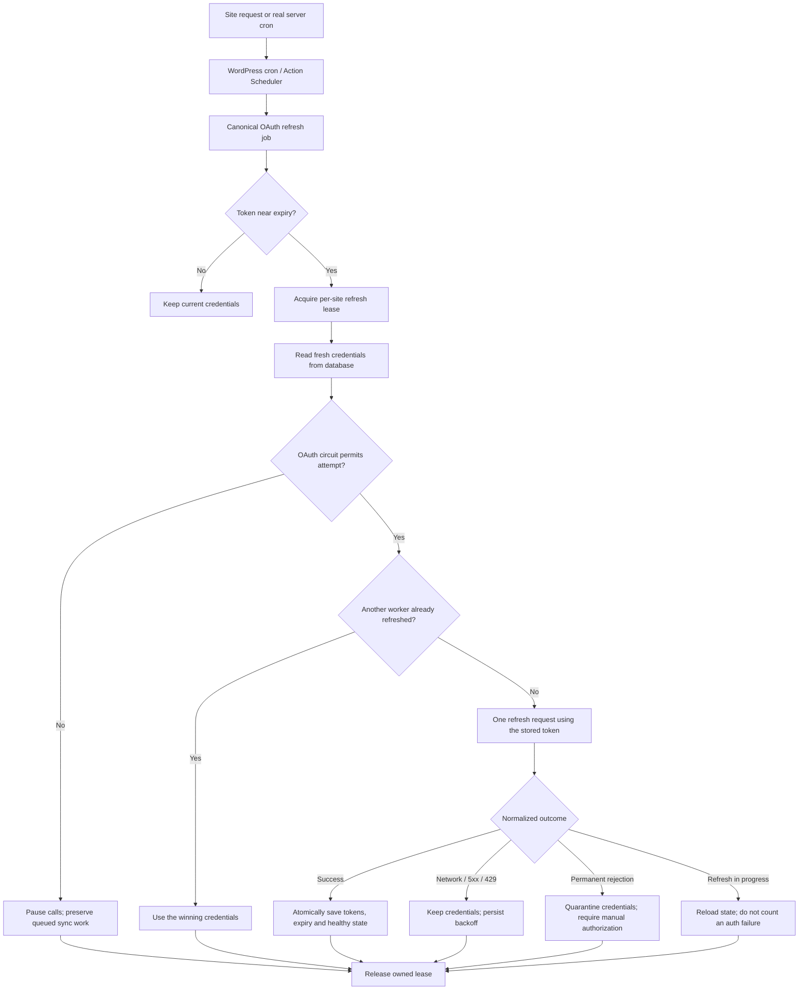

# OAuth refresh reliability on low-traffic websites

The client changes make token refresh safer when cron jobs, queue workers, and administrator requests overlap. They also stop repeated refresh/reconnect attempts when a connection is permanently invalid. On low-traffic sites, this means fewer wasted requests, less chance of losing a rotated token, and sync work that can resume after recovery.

**Status:** implemented in the Syncly client working tree. The OAuth proxy has not been changed because its repository was unavailable. No production accounts, database contents, or queues were changed during development.

## Why low traffic makes this harder

WordPress cron usually starts when a request reaches the site. Action Scheduler normally depends on that trigger too. A quiet website can therefore run scheduled work late. When traffic returns, overdue work and new requests can overlap, making duplicate refresh attempts particularly costly with rotating, single-use refresh tokens.

The existing background refresh check runs on a 20-minute schedule and considers refreshing within 12 hours of token expiry. That early-refresh window was retained. The new changes improve coordination, persistence, and recovery around those checks; they do not create an independent execution service.

## How the refresh flow now works

The diagram shows the scheduled path. Silent reconnect and authorization-code exchange also use the same refresh lease. A worker that cannot acquire the lease reloads credentials and either uses a fresh winner or returns a recoverable authentication error.

## What changed and why it helps

| Change | Reliability benefit |
| --- | --- |
| **One shared refresh path** | Silent reconnect no longer makes an independent refresh-proxy call or launches a reconnect fallback after failure. Overlapping entry points coordinate through the client. |
| **Owned database lease and fresh reads** | The refresh token is selected after acquiring the lease. A stale worker can use another worker’s new credentials instead of consuming an old token. An expired owner cannot delete a replacement lock, and a stale cached lock is discarded when the database shows it was released. |
| **Atomic encrypted credential bundle** | Access token, refresh token, expiry, and successful health state are committed together in `syncly_oauth_state`. Revision checks reject stale writes. General settings saves cannot overwrite the winning credentials. Existing credentials migrate from `syncly_settings`. |
| **Normalized permanent errors** | Nested proxy responses such as HTTP 400 `data.response.error = invalid_grant` and inactive-location errors are recognized. Unusable credentials are quarantined, verification is unset, automatic refresh is unscheduled, and an administrator receives a throttled notice. |
| **Persistent circuit and backoff** | Network/5xx failures preserve tokens and delay retries by 5 minutes, 15 minutes, 1 hour, then up to 6 hours. HTTP 429 honors `Retry-After` when available. Success clears stale failure metadata. Lock contention and duplicate/in-progress responses do not increase the provider failure count. |
| **Canonical recurring schedules** | Scheduling uses the hook, arguments, `syncly` group, and `unique=true`. A serialized version-3 migration replaces duplicate pending recurring chains while preserving completed history and pending one-shot actions. OAuth refresh also has a WP-Cron fallback. |
| **Queue health gate** | Queue processing stops while reconnection is required or backoff remains active. Authentication-blocked items remain recoverable rather than repeatedly consuming their retry budget. |
| **No immediate timeout retry** | A timed-out request may already have consumed the single-use token upstream. The client avoids immediately submitting that token again or starting a refresh/reconnect pair. |
| **Site Health scheduling check** | An overdue refresh job prompts a recommendation to check server cron, making delayed execution visible to administrators. |

## Classes and files

Three helpers were added under `src/API/OAuth/`:

- `OAuthFailure.php`: safe error normalization, failure categories, backoff policy, and queue authentication-error classification.
- `OptionMutex.php`: atomic lease acquisition, expired-lease replacement, stale-cache recovery, and ownership-safe release.
- `RecurringSchedule.php`: shared scheduling, uniqueness, migration, and cron fallback.

The existing `Client.php`, `OAuthHandler.php`, `SettingsRepository.php`, and `QueueManager.php` were updated to use these helpers. Connection verification consumers inherit the health check through their existing repository delegation.

## What this means for an idle website

If a quiet site receives a request while a token is approaching expiry, the scheduled refresh check can renew it early. If several workers run together, the lease coordinates token rotation and stale workers reload the winning state. If the provider is temporarily unavailable, the site waits before retrying and preserves both credentials and queued work. If the token is permanently rejected, the site stops automatic attempts until manual authorization succeeds.

**A website receiving no requests still needs a real server cron trigger.** Configure the host to invoke WordPress cron regularly, and confirm that due Action Scheduler jobs execute. Neither the 20-minute schedule nor its fallback guarantees execution without a trigger.

Proxy idempotency remains outstanding. Client coordination cannot fully recover a successful upstream rotation whose response was lost, or coordinate every caller across separate installations. Atomic proxy reservations and secure short-lived response replay—or a distinct in-progress response—still need implementation. Already-consumed tokens may require manual reauthorization; this does not establish that the entire token family was invalidated.

## Validation and rollout

The full suite passed on PHP 7.4 and PHP 8.5: **173 tests and 34,584 assertions on each runtime**. Syntax checks passed for all 10 changed PHP files. Composer validation, lint, whitespace checks, and coding-standard checks for the new helpers and regression file passed. Concurrency coverage uses simulated workers rather than a live WordPress database.

After the remaining proxy changes are completed, deploy the proxy first, upgrade the clients, let scheduling initialization run the deduplication migration, reauthorize broken accounts once, and configure real cron on idle sites. Monitor normalized outcomes and circuit state alongside scheduling delays.
